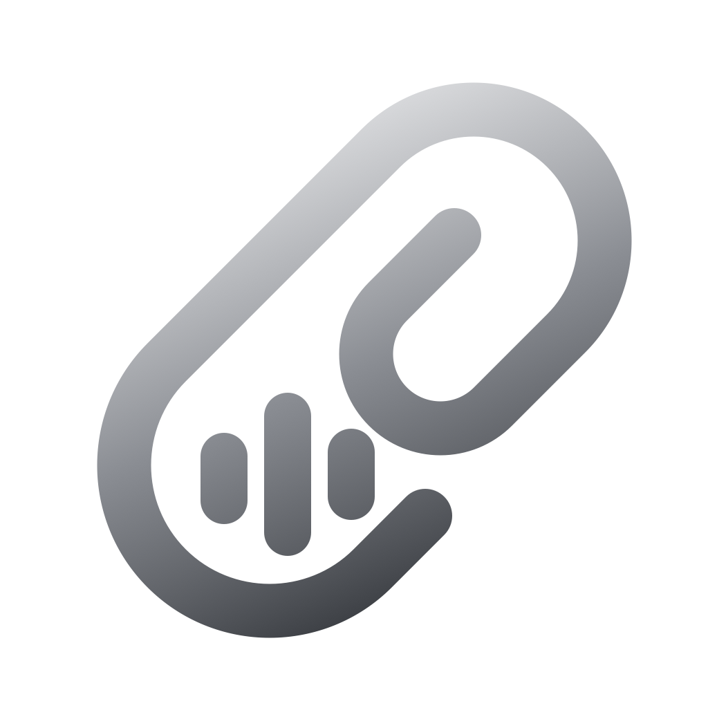

#  Prosody

Prosody is a macOS menu bar app for recording and dictation. Capture system audio, your microphone, or both; save searchable Markdown transcripts; or speak into the text field where you are working. Speech recognition runs on your Mac with Parakeet Unified.

**Source snapshot · macOS 15 or later · Apple silicon**

[Handbook](docs/USING_PROSODY.md) · [Contributing](CONTRIBUTING.md) · [Security](SECURITY.md)

## Source snapshot

This snapshot contains source and documentation only. It does not include a signed installer or release assets. See [Build and source terms](#build-and-source-terms).

## Record or dictate

- **Set up speech recognition:** Click Prosody in the menu bar, open **Settings → Models**, and click **Download** for **Parakeet Unified**. The download needs internet access; recognition then runs locally.
- **Record:** In **Settings → Audio**, select your source and click **Request Permissions**. Open the menu bar recorder and click **Start Recording**, then **Pause**, **Resume**, or **Finish**.
- **Dictate:** Enable **Accessibility** in **Settings → Dictation** and allow microphone access. Click a text field, hold **Right Command** as you speak, then release. You can start the next dictation while an earlier result is being prepared or delivered; a small queue keeps results in order. Press **Escape** to cancel unfinished dictation.
- **Find and play a transcript:** Open **Transcripts** to search titles and labels, filter by retained audio, or copy plain text or Markdown. Turn on **Include Dictation** to show saved dictations. When audio is available, click a timestamp or drag the timeline; use **Follow Audio** to follow the highlighted passage.
- **Customize:** Use **Settings → Appearance** to choose from 91 themes, **Tray Elements** to choose which controls appear in the compact recorder, or **Labels** to set names, colors, naming patterns, and folders.

See [Using Prosody](docs/USING_PROSODY.md) for click paths, keyboard shortcuts, transcript-reader limits, recovery, and backups.

## Data and privacy

Audio capture, speech recognition, and the default **Offline Outline** notes run on your Mac. **Local-only mode** is on by default and restricts notes requests to local endpoints. If you turn it off and configure a remote notes provider, that provider receives transcript text and notes context when it generates notes. Transcripts and optional retained audio are saved in your output folders. Provider credentials stay in the macOS Keychain.

## Build and source terms

With Swift 6 and Xcode selected, run from a local checkout:

```sh
./script/build_and_run.sh
```

See the [development guide](docs/DEVELOPMENT.md), [architecture](docs/ARCHITECTURE.md), [contributing guide](CONTRIBUTING.md), and [release validation guide](docs/release-validation.md). For sensitive issues, follow the [security policy](SECURITY.md).

Prosody's source and assets are covered by [LICENSE](LICENSE): **all rights reserved**. This repository is not offered under an open-source license. Third-party notices for FluidAudio and downloadable models are in [Resources/ThirdPartyNotices/README.md](Resources/ThirdPartyNotices/README.md).
